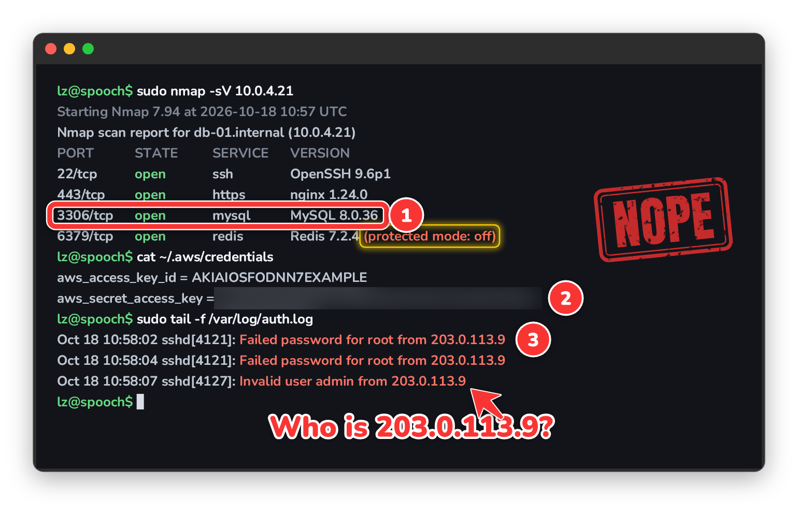
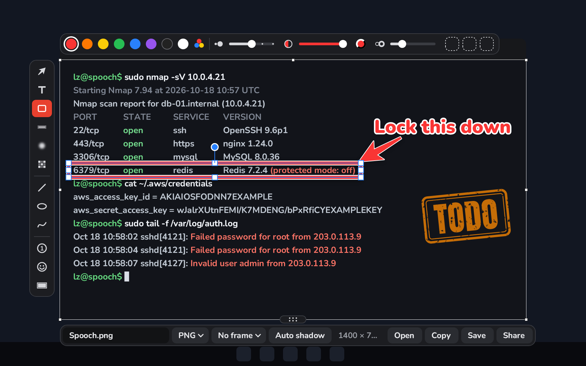
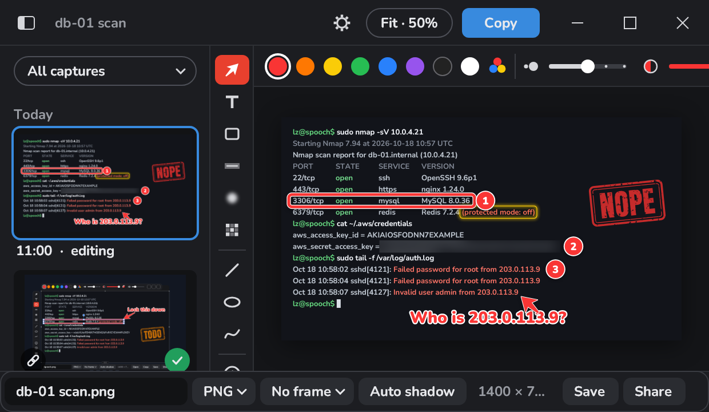
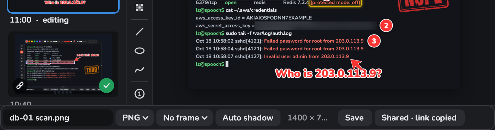

# Spooch

A fast, native screenshot markup tool in the spirit of Skitch. Press a
hotkey, the screen freezes, mark up the part you want in place, then copy,
save, drag or share it.



Spooch works without an account. Nothing leaves your computer unless you
sign in, share or turn on sync.

## Download

Get the newest release from
[GitHub Releases](https://github.com/ycamper/spooch/releases/latest):
`spooch-<version>-windows-x64.zip` or `spooch-<version>-linux-x86_64.tar.gz`.

- **Windows** 10 or 11, x64. Unzip anywhere and run `spooch.exe`, keeping
  `msvcp140.dll` and `vcruntime140.dll` next to it. The build isn't signed,
  so SmartScreen asks the first time: More info, then Run anyway.
- **Linux** on X11 (not Wayland), x86_64, with FreeType, Fontconfig and a
  glibc as new as Ubuntu 22.04's. Run `./spooch-x11`. Signing in needs
  `zenity`. GNOME shows the tray icon only with the AppIndicator extension;
  the shortcuts work without it.
- Spooch starts in the tray with no window. Press **Ctrl+Shift+2**.
- To check a download, compare it with `SHA256SUMS` from the same release:
  `Get-FileHash <zip>` on Windows, `sha256sum -c --ignore-missing SHA256SUMS`
  on Linux.
- To uninstall: in Settings, turn off "Use the Print Screen key" (on
  Windows it hands the key back) and "Start when I sign in" ("log in" on
  Linux), sign out, quit, then delete the app's folder and the folders
  under [Settings and files](#settings-and-files).

## Features

### Capture and markup

The screen freezes; drag out an area, or click to take a whole monitor.
You mark it up right there, then copy it and go.



- **Ctrl+Shift+2** to capture, **Ctrl+Shift+3** after a countdown.
- Ten tools on the number keys: arrow, box, highlight, blur, pixelate,
  line, ellipse, pen, numbered steps and redact. Just type for a label.
- Stickers, rubber stamps and mouse pointers from the rail.
- Drag the capture's edges to crop it, or past them to take in more.
- **Enter** copies, **Ctrl+S** copies and saves, **Ctrl+drag** drops a file
  into another app.

### Editor window and Recents

**Ctrl+E** moves a capture into a window, next to everything you captured
lately.



- Zoom in and out, or fit the window.
- Every capture is kept in Recents, so any of them can be reopened and
  edited, marks and all.
- Wrap an export in a window, browser or terminal frame, with a shadow.
- The gear opens Settings.

### Sharing and sync

Share puts a capture online and copies the link; sync keeps your captures
on all your computers.



- **Ctrl+Shift+U** shares: a public link, copied to the clipboard, that
  lasts 30 days.
- With sync on, captures appear in every signed-in Spooch's Recents, with
  a badge for where each one stands.
- Sign up or sign in from Settings, under Account, and turn on "Sync
  captures" there.
- Accounts are invite-only. Set a public email on your GitHub profile, then
  [open an issue](https://github.com/ycamper/spooch/issues/new) asking for
  a sign-up code. Don't post your email; the code is sent to the one on
  your profile.

## Shortcuts

Anywhere, changeable in Settings:

| Shortcut | Does |
| --- | --- |
| Ctrl+Shift+2 | Capture |
| Ctrl+Shift+3 | Capture after a countdown (3 s) |
| Ctrl+Alt+Shift+2 | Reopen the last capture |
| Print Screen | Capture, once "Use the Print Screen key" is on |
| not set | Quit Spooch |

In the editor:

| Key | Does |
| --- | --- |
| 1 to 0 | Arrow, box, highlight, blur, pixelate, line, ellipse, pen, steps, redact |
| Shift+1 to Shift+8 | Pick a colour |
| [ and ] | Smaller and bigger |
| Enter or Ctrl+C | Copy |
| Ctrl+S | Copy and save |
| Ctrl+Shift+U | Share |
| Ctrl+Z, Ctrl+Y | Undo, redo |
| Ctrl+D, Delete | Duplicate, delete the selected mark |
| Arrow keys | Nudge the selected mark, or else a capture edge (Shift: 10 px) |
| PageUp, PageDown | Step through Recents |
| Ctrl+E | Open in the editor window |
| Ctrl+H, Ctrl+0, Ctrl+1 | In the window: hide Recents, fit, actual size |
| Esc or right-click | Cancel |

## Settings and files

Settings is in the tray icon's menu and behind the editor's gear. It writes
`settings.txt`, which you can also edit; it reloads when saved. Custom
frames go in the `frames` folder next to it. Recents keeps captures for 30
days or up to 2 GB.

| | Windows | Linux |
| --- | --- | --- |
| Settings | `%APPDATA%\Spooch` | `~/.config/spooch` |
| Saved captures | `Pictures\Spooch` | `$XDG_PICTURES_DIR/Spooch` |
| Recents | `%LOCALAPPDATA%\Spooch\Recents` | `~/.local/share/spooch/recents` |
| Drag-out files | `%TEMP%\Spooch\drag` | `~/.cache/spooch/drag` |
| Log | `%LOCALAPPDATA%\Spooch\spooch.log` | `~/.local/state/spooch/spooch.log` |

## Development

### Layout

| Crate | What it is |
| --- | --- |
| `spooch-platform` | Settings, Recents, saving, the log and the shared app flow (tray menu, shortcuts, countdown) |
| `spooch-render` | The editor on Skia: `Document` (marks, tools, undo, chrome, frames, the editor window's view and gallery) |
| `spooch-app` | `Picker` and `Session`: picking an area and editing one capture, as every shell drives them |
| `spooch-share` | HTTP client for the sharing and sync service, and the keychain device token |
| `spooch-shell-win` | Windows shell (`windows-rs`), bin `spooch` |
| `spooch-shell-x11` | Linux X11 shell (`x11rb`, no toolkit), bin `spooch-x11` |

All editor behaviour lives in `spooch-render` and `spooch-app`; the shells
translate OS input and show pixels.

### Build and run

Windows (MSVC):

```
cargo build --release -p spooch-shell-win
target\release\spooch.exe [--backend=dxgi|gdi] [--no-recents] [--editor] [--welcome]
```

Linux, from an X11 session:

```
sudo apt install libfreetype-dev libfontconfig-dev   # Fedora: freetype-devel fontconfig-devel
cargo run --release -p spooch-shell-x11 [-- --backend=shm|getimage]
```

`skia-safe` downloads prebuilt Skia binaries, which exist for the MSVC and
Linux targets; cross-compiling to `windows-gnu` isn't supported.

### Checks

```
cargo fmt --all
cargo clippy --workspace --all-targets -- -D warnings
cargo test --workspace
```

### Benchmark

```
cargo run --release -p spooch-render --bin spooch-render-bench [screenshot.png] [--out bench.png]
```

Times a full editor frame (screenshot, ten arrows, a blurred region),
single arrows, blur and pixelate over a 2560x1440 desktop, then writes a
PNG to check the arrows by eye.

### README images

```
cargo run --release -p spooch-render --example readme_images
```

Draws the images above through the editor into `assets/readme/`, each at
most 300 KB. Commit them from Windows, and only when what they show
changes; on Linux, take them from CI's `readme-images` artifact instead.
If a size changes, update the `width` on its `` to half the new pixel
width.

## License

Licensed under either of [Apache License, Version 2.0](LICENSE-APACHE) or
[MIT license](LICENSE-MIT), at your option. The bundled fonts are under the
SIL Open Font License and the stickers are Microsoft's Fluent Emoji (MIT);
their licenses sit next to them in `crates/spooch-render`.
